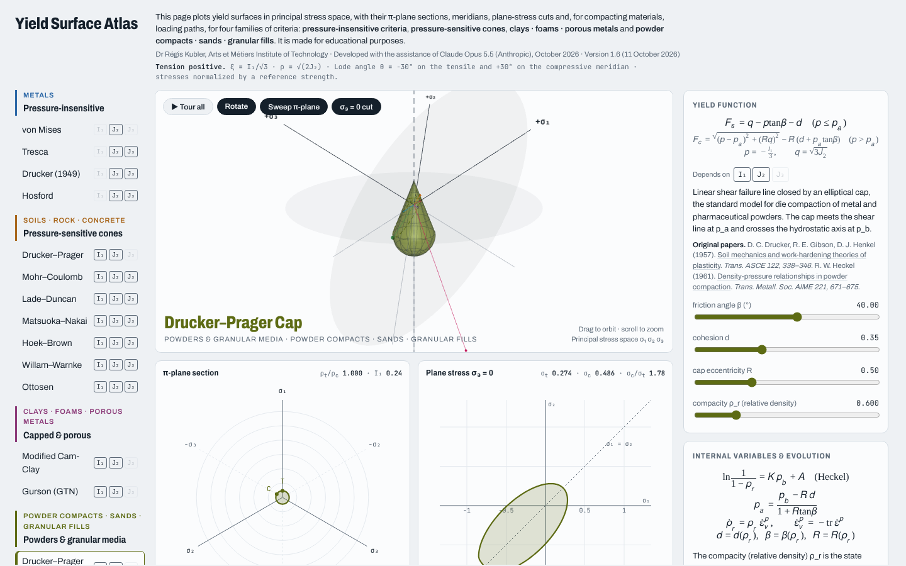

# Yield Surface Atlas

**Live page:** `https://rkubler.github.io/yield-surface

This page plots yield surfaces in principal stress space, with their π-plane sections, meridians, plane-stress cuts and, for compacting materials, loading paths. It covers four families of criteria, all written in the stress invariants I₁, J₂ and J₃ (Lode angle):

- **Pressure-insensitive criteria (metals):** von Mises, Tresca, Drucker (1949), Hosford, Cazacu–Barlat (2004)
- **Pressure-sensitive cones (soils, rock, concrete, ductile metals):** Drucker–Prager, Mohr–Coulomb, Lade–Duncan, Matsuoka–Nakai, Hoek–Brown, Willam–Warnke, Ottosen, Bai–Wierzbicki (2008)
- **Clays · foams · porous metals:** Modified Cam-Clay, Gurson (GTN)
- **Powder compacts · sands · granular fills:** Drucker–Prager Cap, DiMaggio–Sandler, Kuhn–Downey, SANISAND (closed)
- **Stress-activated martensitic transformation**

It is made for educational purposes.

**Author:** Dr Régis Kubler, Arts et Métiers Institute of Technology
Developed with the assistance of Claude Opus 5.5 (Anthropic), October 2026
**Version 1.6** (11 October 2026)

## What the page shows

- **3D view:** the surface rotating in principal stress space, with the hydrostatic axis, the π-plane sweep and the σ₃ = 0 cut. A second tab gives the classical σ₁σ₂σ₃ view: a parallel (cabinet oblique) projection with σ₁ horizontal to the right, σ₂ vertical upward and σ₃ toward the viewer.
- **π-plane section:** the deviatoric section at any position ξ along the hydrostatic axis.
- **Plane stress σ₃ = 0:** the biaxial cut, with tensile and compressive strengths and their ratio.
- **Meridians ρ(ξ) or q(p):** the tensile and compressive meridians, with their characteristic points (radii at ξ = 0, apex, cap end, uniaxial strengths) and values, with a switch between the Haigh–Westergaard axes ξ–ρ and the soil-mechanics axes p–q (default for the cap, porous and granular models).
- **Lode dependence ρ(θ)** (criteria that use J₃): the deviatoric radius of the current π-plane slice against the Lode angle, from the tensile (θ = −30°) to the compressive (θ = +30°) meridian. The π-plane marks the Lode-angle sector, and moving the pointer over it probes θ and ρ in any direction.
- **Compaction & densification** (cap, porous and granular models): proportional loading paths from the current state, namely uniaxial tension and compression, equibiaxial tension and compression, pure shear, hydrostatic compression and confined compression (K₀ = 0.5). For each path the page plots the plastic volumetric strain and the compacity against the applied stress ‖σ‖, on a linear or log axis. Compacting paths run up to full density; dilatant paths loosen the material or grow its voids, toward the loosest state.
- **Internal variables:** each model with a state variable (cap position, compacity, void fraction, back-stress) shows its evolution law, and the surface can be animated as that variable changes.
- **Full view:** every plot has a ⤢ button that opens it full window, with zoom, pan, typed axis ranges, a data readout and PNG export, or as a separate page in a new window.
- **Overlay:** two surfaces can be superimposed for comparison.
- **Equations:** the classical form (principal stresses or invariants) is always shown first, then the Lode-angle form where it exists.
- **Parameters to identify:** the material constants of each yield function are shown in purple, counted on each model button and explained under the equations. Each family has an Overview table of its models, typical uses and parameters.
- **References:** the original paper for each model is shown under its description.
- **Tresca sub-page** (`tresca.html`, opened from the Tresca equations): the polynomial form 4J₂³ − 27J₃² − 9σ₀²J₂² + 6σ₀⁴J₂ − σ₀⁶ = 0 given by Lubliner (1990), why it describes six full planes bounding two triangular prisms, and the extra condition 3J₂ ≤ σ₀² that keeps only the Tresca hexagon.

## Folder contents

| File | Purpose |
|---|---|
| `index.html` | The whole application, in one self-contained file |
| `assets/preview.png` | Screenshot used in this README |
| `.nojekyll` | Tells GitHub Pages to serve the files as they are |
| `CHANGELOG.md` | Version history |
| `LICENSE` | MIT license |
| `CITATION.cff` | Citation metadata (GitHub shows a "Cite this repository" button) |
| `tresca.html` | Tresca sub-page: the polynomial form of Lubliner (1990), its six planes and two triangular prisms, with π-plane and plane-stress sections |

## Browser requirements

The 3D view needs WebGL. If a browser shows a WebGL message, check that hardware acceleration is on and that WebGL is not disabled (in Firefox: `about:support` and the `webgl.disabled` setting in `about:config`). The equations, the 2D sections and the loading paths work without WebGL.

## Conventions

Tension is positive. ξ = I₁/√3 and ρ = √(2J₂) are the Haigh–Westergaard coordinates; the Lode angle θ is −30° on the tensile meridian and +30° on the compressive one. Stresses are normalized by a reference strength. Surfaces are computed in the browser by solving each criterion along rays in Haigh–Westergaard space. The loading paths use associated flow and neglect elastic strains.

## Author and acknowledgement
Dr Régis Kubler, Arts et Métiers Institute of Technology.
The simulator was developed with the assistance of Claude Opus 5.5 (Anthropic),
October 2026. All content was reviewed by the author.

## Licence
Code: MIT, see [LICENSE](LICENSE). Documentation: CC BY 4.0.

## Cite as
Kubler, R. (2026). *Yield Surface Simulator*. Arts et Métiers Institute of Technology. Zenodo. DOI:https://doi.org/10.5281/zenodo.23319332 
