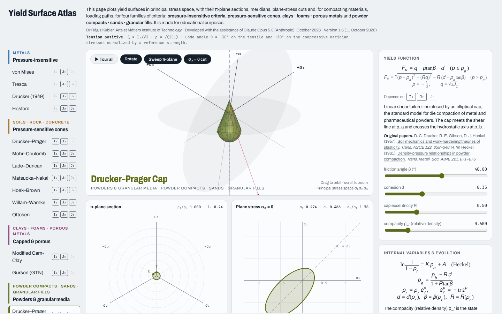

# Yield Surface Atlas

**Live page:** `https://<user>.github.io/<repo>/` (once GitHub Pages is enabled, see below)

This page plots yield surfaces in principal stress space, with their π-plane sections, meridians, plane-stress cuts and, for compacting materials, loading paths. It covers four families of criteria, all written in the stress invariants I₁, J₂ and J₃ (Lode angle):

- **Pressure-insensitive criteria (metals):** von Mises, Tresca, Drucker (1949), Hosford, Cazacu–Barlat (2004)
- **Pressure-sensitive cones (soils, rock, concrete, ductile metals):** Drucker–Prager, Mohr–Coulomb, Lade–Duncan, Matsuoka–Nakai, Hoek–Brown, Willam–Warnke, Ottosen, Bai–Wierzbicki (2008)
- **Clays · foams · porous metals:** Modified Cam-Clay, Gurson (GTN)
- **Powder compacts · sands · granular fills:** Drucker–Prager Cap, DiMaggio–Sandler, Kuhn–Downey, SANISAND (closed)

It is made for educational purposes.



**Author:** Dr Régis Kubler, Arts et Métiers Institute of Technology
Developed with the assistance of Claude Opus 5.5 (Anthropic), October 2026
**Version 1.6** (11 October 2026)

## What the page shows

- **3D view:** the surface rotating in principal stress space, with the hydrostatic axis, the π-plane sweep and the σ₃ = 0 cut.
- **π-plane section:** the deviatoric section at any position ξ along the hydrostatic axis.
- **Plane stress σ₃ = 0:** the biaxial cut, with tensile and compressive strengths and their ratio.
- **Meridians ρ(ξ):** the tensile and compressive meridians.
- **Compaction & densification** (cap, porous and granular models): proportional loading paths from the current state, namely uniaxial tension and compression, equibiaxial tension and compression, pure shear, hydrostatic compression and confined compression (K₀ = 0.5). For each path the page plots the plastic volumetric strain and the compacity against the applied stress. Compacting paths run up to full density; dilatant paths loosen the material or grow its voids, toward the loosest state.
- **Internal variables:** each model with a state variable (cap position, compacity, void fraction, back-stress) shows its evolution law, and the surface can be animated as that variable changes.
- **Overlay:** two surfaces can be superimposed for comparison.
- **References:** the original paper for each model is shown under its description.

## Folder contents

| File | Purpose |
|---|---|
| `index.html` | The whole application, in one self-contained file |
| `assets/preview.png` | Screenshot used in this README |
| `.nojekyll` | Tells GitHub Pages to serve the files as they are |
| `CHANGELOG.md` | Version history |
| `CITATION.cff` | Citation metadata (GitHub shows a "Cite this repository" button) |

## Publish on GitHub Pages

1. Create a repository and upload the contents of this folder at its root (or inside a `docs/` folder).
2. In the repository, open **Settings → Pages**. Under **Build and deployment**, choose **Deploy from a branch**, then pick the branch (`main`) and the folder (`/root` or `/docs`).
3. After a minute the page is live at `https://<user>.github.io/<repo>/`.

No build step is needed. The page loads three.js r128, its OrbitControls and KaTeX 0.16.9 from public CDNs, and the Archivo and JetBrains Mono fonts from Google Fonts.

To embed it in another page:

```html
<iframe src="https://<user>.github.io/<repo>/" width="100%" height="900" style="border:0"></iframe>
```

## Browser requirements

The 3D view needs WebGL. If a browser shows a WebGL message, check that hardware acceleration is on and that WebGL is not disabled (in Firefox: `about:support` and the `webgl.disabled` setting in `about:config`). The equations, the 2D sections and the loading paths work without WebGL.

## Conventions

Tension is positive. ξ = I₁/√3 and ρ = √(2J₂) are the Haigh–Westergaard coordinates; the Lode angle θ is −30° on the tensile meridian and +30° on the compressive one. Stresses are normalized by a reference strength. Surfaces are computed in the browser by solving each criterion along rays in Haigh–Westergaard space. The loading paths use associated flow and neglect elastic strains.
